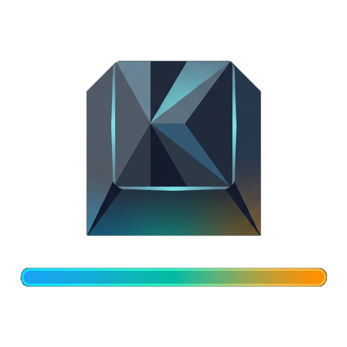

# KLAMBA

<p align="center">

</p>

**KLAMBA**, Linux masaüstü (öncelikli olarak **KDE Plasma 6**) için geliştirilmiş, laptop gömülü klavyelerinin arka aydınlatmasını (RGB renk, parlaklık, profil ve küresel kısayollar) yöneten hafif bir PySide6 uygulamasıdır.

## Özellikler

* **Otomatik SysFS Algılama:** Standart Linux Multi-Color LED (`/sys/class/leds/*kbd_backlight*`) ve TUXEDO/Clevo platform (`/sys/devices/platform/tuxedo_keyboard/`) arayüzlerini otomatik tanır.

* **Canlı Klavye Önizleme:** Renk ve parlaklık değişikliklerini anlık olarak arayüzde gösterir.

* **Özel Profiller & Sistem Tepsisi:** Hazır ve özel profilleri kaydeder; sistem tepsisi (tray) menüsünden hızlı geçiş sunar.

* **Tek Tıkla Şifresiz Erişim:** Uygulama içinden `pkexec` ile `udev` kuralı kurarak her seferinde `sudo` şifresi sormadan kontrol sağlar.

* **KDE Kısayol Desteği:** `--toggle`, `--brightness-up`, `--brightness-down` ve `--next-profile` komutlarıyla KDE Sistem Ayarları üzerinden küresel kısayol atanabilir.

## Desteklenen Donanımlar ve Gereksinimler

| Bileşen | Destek Durumu | Not | 
| ----- | ----- | ----- | 
| **Clevo / TUXEDO / Monster / XMG / Schenker** | Tam Destek (RGB + Parlaklık) | [`tuxedo-drivers-dkms`](https://aur.archlinux.org/packages/tuxedo-drivers-dkms) veya [`tuxedo-drivers-nocompatcheck-dkms`](https://aur.archlinux.org/packages/tuxedo-drivers-nocompatcheck-dkms) gerektirir. | 
| **Standart `kbd_backlight` Sunan Laptoplar (ThinkPad, Dell, HP)** | Kısmi Destek (Parlaklık) | Çekirdeğin sunduğu tek renk parlaklık kontrolü çalışır. | 
| **Özel USB HID RGB Klavyeler (ASUS ROG, MSI, Razer vb.)** | Desteklenmiyor | SysFS yerine özel USB protokolü kullandıkları için uygulama **Önizleme Modu**nda açılır. | 
| **Dağıtımlar** | Arch/CachyOS, Ubuntu/Debian, Fedora, openSUSE | Python 3 + `PySide6` gerektirir. KDE Kısayolları otomasyonu KDE Plasma 6 için tasarlanmıştır. | 

## Kurulum

```
git clone https://github.com/abra003/klamba.git
cd klamba
chmod +x install_klamba.bash
./install_klamba.bash

```

> **Monster / Clevo Cihazlar İçin Sürücü Notu (Arch / CachyOS):**
> Eğer uygulama **Önizleme Modu**nda açılıyorsa çekirdek sürücüsü yüklü olmayabilir:
>
> ```
> sudo pacman -S --needed linux-cachyos-headers
> yay -S tuxedo-drivers-nocompatcheck-dkms
> sudo modprobe tuxedo_keyboard clevo_acpi
> 
> ```

## CLI Kısayol Komutları

```
klamba --toggle           # Işığı kapat / önceki parlaklıkla aç
klamba --brightness-up    # Parlaklığı %15 artır
klamba --brightness-down  # Parlaklığı %15 azalt
klamba --next-profile     # Sonraki profile geç

```

## Lisans

Bu proje [MIT Lisansı](https://www.google.com/search?q=LICENSE) altında sunulmaktadır.
